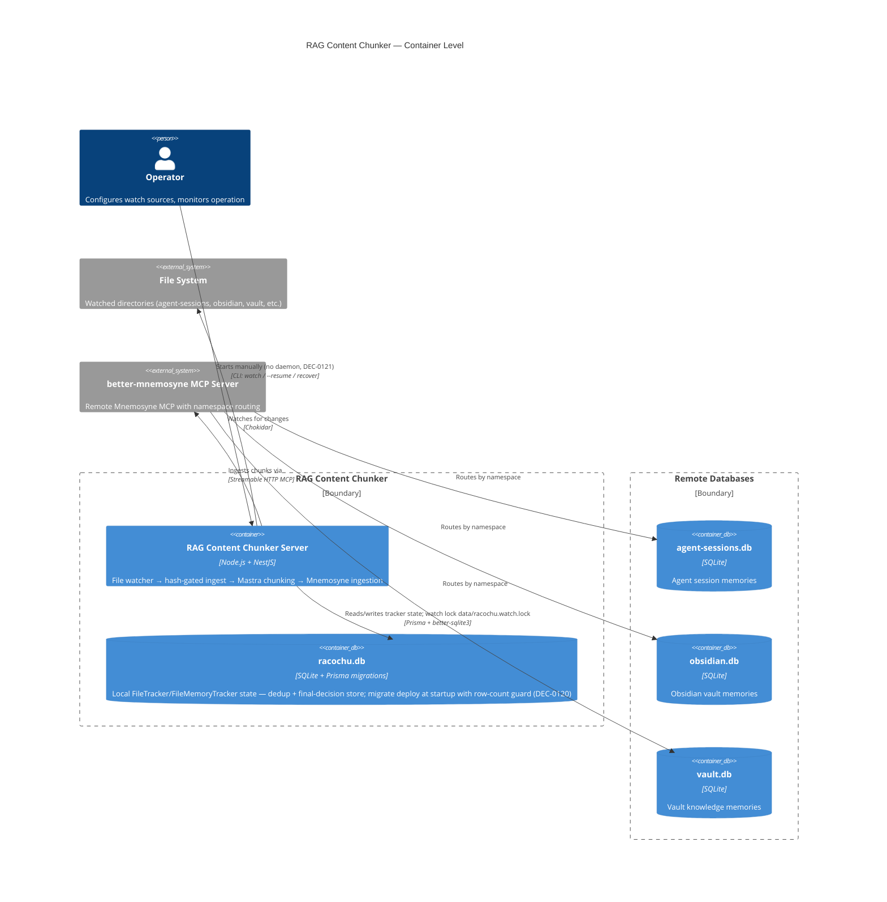

# Container: RAG Content Chunker — Server Container

## Diagram

## Elements

| ID | Name | Type | Technology | Description |
|----|------|------|-----------|-------------|
| `server` | RAG Content Chunker Server | Container | Node.js + NestJS 11 | Single-process CLI server: watches files, content-hash-gates the ingest decision (DEC-0119), chunks via Mastra, enhances, ingests to Mnemosyne |
| `trackerDb` | racochu.db | ContainerDb | SQLite (Prisma + better-sqlite3, N-API) | Local tracker state: `FileTracker` (final-decision store incl. `fileHash`, `skipReason`) + `FileMemoryTracker`; schema managed by committed migrations at startup with a fail-loud dedup row-count guard (DEC-0120) |
| `filesystem` | File System | System_Ext | — | Watched directories defined in config (up to multiple sources) |
| `mnemosyne` | better-mnemosyne MCP Server | System_Ext | Python + MCP | Remote namespace-aware Mnemosyne server; routes per namespace to separate SQLite DBs |

## Notes

- **Single-container design:** RAG Content Chunker is a single NestJS CLI process — no separate workers, APIs, or microservices
- **Transport:** Streamable HTTP (not SSE, not stdio) — SSE deprecated in Mnemosyne due to init handshake races
- **Stateful-local (corrected 2026-11-01):** an earlier note said "no database on the RAG Content Chunker side" — outdated: `data/racochu.db` (Prisma SQLite) has held FileTracker/FileMemoryTracker state since the tracking feature and is now the load-bearing dedup + final-decision store (DEC-0119/DEC-0120). Memories themselves stay remote in Mnemosyne. Runtime artifacts: watch single-instance lock `data/racochu.watch.lock` (DEC-0121), committed schema migrations `prisma/migrations/` applied at startup (DEC-0120).
- **Operating model:** operator-run CLI, no daemon (DEC-0121) — overlapping second watchers are refused by the lock; one-shot modes may overlap.
- **Graceful shutdown:** SIGTERM/SIGINT → stop watchers → drain queue → close Mnemosyne client (30s timeout)
