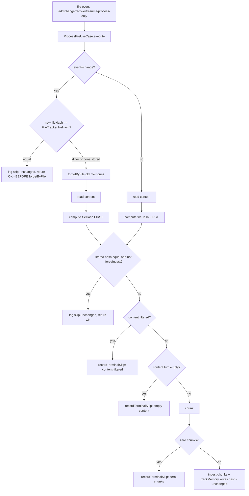

# DEC-0119: Content-Hash Ingest Gate at the ProcessFileUseCase Choke Point + Terminal-Skip Quarantine

## Context

racochu repeatedly re-ingested already-known files (measured Oct 12–31, 2026: 81% of touched files
queued >1×; one 4.1 MB transcript re-ingested 135× in one hour; ~243 never-succeedable files
re-queued on every resume/auto-populate). Root causes confirmed by log/DB forensics
(session `261031-0953-bootstrap-researcher`, findings §6): no content/hash comparison anywhere on
the ingest decision (the hash was computed, stored in `FileTracker.fileHash`, and never used);
any change event triggered a destructive full forget+re-ingest; 0-byte/0-chunk/content-filtered
files never recorded a tracker row, so they were permanently "untracked"; batch CLI modes
re-queued the entire corpus unconditionally.

## Decision

1. **Gate at the single choke point** — `ProcessFileUseCase` (`src/use-cases/process-file.use-case.ts`),
   the class already documented as "the ingest gate covering --watch, --process-only, and --resume".
   In `handleChange` the unchanged-file check runs **before** `getMemoryIds`/`forgetByFile`
   (post-forget skipping would tombstone live memories with no re-ingest = silent data loss; the
   DEC-0036 forget-ordering stays load-bearing and is test-enforced as an order-guard); in
   `ingestFile` the hash is computed first and compared right after the content read.
2. **Comparison rule copied from DEC-0084** (`RecoverService` step 5): skip only when
   `storedHash !== null && computable && equal`; everything else proceeds as before, so legacy
   null-hash rows and hash-compute failures are never silently starved. **Fail-open is
   mandatory** (DB read or hash failure ⇒ proceed) — the worst outcome of the gate must equal the
   pre-gate status quo, never file loss.
3. **Quarantine = terminal-skip rows in `FileTracker`** (option 2a, not a side table):
   empty-content / zero-chunk / content-filtered outcomes record a row carrying the content hash +
   nullable `skipReason` (`'content-filtered' | 'empty-content' | 'zero-chunks'`) and zero memory
   rows (`recordTerminalSkip` via `FileMemoryTrackerService`; the write is non-fatal — failure
   degrades to today's retried-until-success behavior). Aggregate invariant
   (`src/domain/file-tracker.aggregate.ts` docstring): *a FileTracker row means racochu has seen
   this exact content hash and reached a final decision about it — ingested (memories tracked,
   `skipReason` null) or terminally skipped (`skipReason` set, zero memories)*. A later content
   change makes the hash differ and full re-evaluation naturally re-classifies; successful ingest
   clears `skipReason` alongside the existing hash update. The `content.trim() === ''` pre-check
   lives in the use case — `ChunkContentUseCase`'s `content.min(1)` contract stays intact for
   programmatic callers.
4. **`forceIngest` parameter** (default false, zod-validated) at exactly the deliberate
   corrective sites: `--force-reprocess`, the resume **stale-tracker** branch (bank verification
   already proved loss — local hash equality must not veto a repair; DEC-0082/0084
   verified-before-trusted semantics), and `RecoverService` step-4 `FILE_NOT_FOUND` / step-5
   re-ingests. Consequently the two formerly identical CLI modes diverge: **`--process-only`
   becomes gated** (safe catch-up), **`--force-reprocess` remains the unconditional override**.
   `--resume`'s untracked branch and the watcher event handlers keep `false`.

Gate flow:

Gate skip contract (both paths): `Skipping unchanged file (hash gate): path=…, fileHash=<first 12 hex>`;
batch paths end with a `… finished: files=…, gated-skips=…, terminal-skip-skips=…, verified-skips=…, re-ingested=…`
summary line (observability, see runbook 0011).

## Alternatives Considered

| Alternative | Pros | Cons | Why rejected |
|-------------|------|------|--------------|
| Per-service gates (A2) | Local to each caller | 4+ call sites, drift-prone, cannot cover the watcher CHANGE path (largest volume) | Only the choke point covers every path |
| Pre-computed skip-list consulted by services (A3) | Cheap reads | Never covers CHANGE events | Misses dominant mechanism M1 |
| Separate skip-list table (option 2b) | Keeps FileTracker consumers blind to skip rows | Second side table + entity + cross-table cleanup in delete/exclude/TTL/reconcile paths; deepens the tracked-state split that caused the M2 bug ("tracked" meaning FileMemoryTracker presence while file identity lives in FileTracker) | 2a unifies "racochu has decided about these exact bytes" into the one table built for it (pattern per DEC-0041); all consumers audited safe (spec §6 impact sweep); recover degrades to deterministic cheap re-skip |
| `FILE_TRACKER_STATUS` enum overload | No new column | The status enum models file *operations* (add/change/delete), not ingest outcomes | Honest modeling favors a parallel nullable field + explicit aggregate invariant |
| Config flag / "trust bank verification inside the gate" for bypass | Fewer params | Hides bypasses from grep/tests; couples the hot path to MCP for every file | A static parameter per call site keeps every gate bypass statically visible and testable (cf. DEC-0106 observability-only precedent) |

## Consequences

- **Positive:** no-op re-ingests eliminated (the ×135 appended-transcript class, Syncthing
  mtime-touch class, ×243 permanent retry set); a repeated whole-corpus pass costs one indexed
  read + one SHA-256 per unchanged file; the ~179 `File processing failed` too_small events
  become honest `terminal-skip-recorded` classifications (by classification change, not muting —
  error logs keep meaning errors); repair paths (stale-tracker resume, recover FILE_NOT_FOUND)
  demonstrably preserved.
- **Negative:** skip-rows (~+250 estimated) appear in FileTracker counts — every consumer audited
  (recover re-hits its skip deterministically at no bank/LLM cost; re-embed sees no chunk work;
  TTL/mass-forget-guard are row-count based, behavior identical to "file existed, nothing to
  forget"). Filter-config changes do not auto-invalidate stale CONTENT_FILTERED rows —
  `--force-reprocess --source X` is the documented escape hatch.
- **Neutral:** `--process-only` semantics change (breaking CLI-contract change, documented in README
  and runbooks); `handleChange` passes its computed hash into `ingestFile` to avoid double hashing;
  real content changes keep the full DEC-0036 change flow by design (no delta re-ingest — non-goal).
